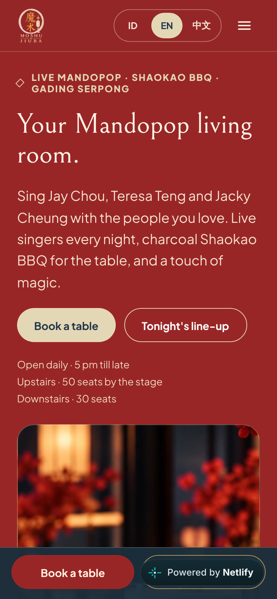
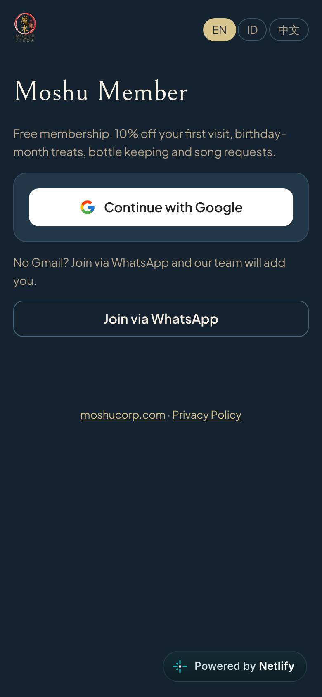
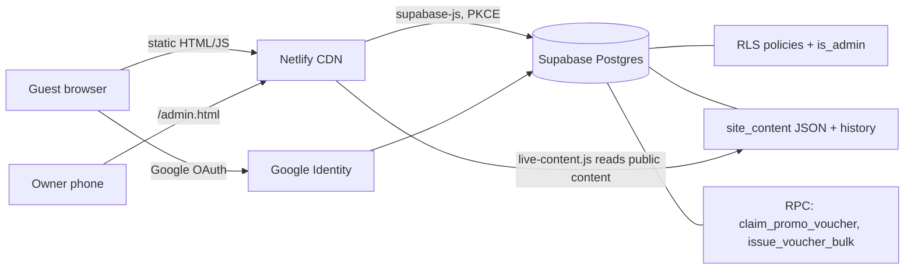

# venue-kit

**A white-label membership and content platform for small hospitality venues: written once, configured per client.**

Bars, cafés and live-music venues usually run on WhatsApp, Instagram and a PDF menu. The owner can't change the website without calling a developer, and they have no member data of their own. venue-kit closes that gap with a few static files and one managed Postgres project. It costs **Rp 0 a month** to run for a single venue.

> **Reference deployment:** [moshucorp.com](https://moshucorp.com) is a Mandarin live-music bar in Gading Serpong, Indonesia. It went from brief to production in 5 days, and the owner now runs it without a developer. → [Case study](docs/CASE-STUDY-moshu.md)

> "John built us a website and a member app, starting with our customers and a full marketing plan. He interviewed me, respected my business plan, and thought through security, access and future growth. In less than a week I could run promotions, the menu and members myself from my phone, at zero monthly cost. Highly recommended."
> Edy, Owner, Moshu Jiuba

| Public site | Member sign-in |
|---|---|
|  |  |

---

## What this project demonstrates

| Competency | Evidence |
|---|---|
| Customer discovery before code | Area and guest research, a marketing plan, and a full owner interview. [Case study: Method](docs/CASE-STUDY-moshu.md) |
| Turning business needs into technical options and trade-offs | Three costed options; the owner chose. [Operating model](docs/OPERATING-MODEL.md) |
| Security and data judgment | RLS on every table, an admin allowlist, and consent capture. [Architecture](docs/ARCHITECTURE.md) |
| End-to-end delivery to production | Brief to live in 5 days, front end and back end. [moshucorp.com](https://moshucorp.com) |
| Production debugging | A sign-in failure on real users' browsers, diagnosed and fixed the same day. [Case study](docs/CASE-STUDY-moshu.md) |
| Enablement and adoption | An owner guide and training; the owner runs it without a developer |
| Turning one engagement into a reusable platform | Templates, per-client config, a build script and a runbook. [Deploy](docs/DEPLOY.md) |
| Continuous improvement | Owner requests shipped within a day, a logged changelog and a roadmap. [Roadmap](docs/ROADMAP.md) |

## What the venue gets

| For guests | For the owner (no code) | For whoever operates it |
|---|---|---|
| Google sign-in, one tap | Admin page, works on a phone | One config file per client |
| Member card with QR code | Edit promotions, menu, singers, weekly line-up, banner | `build_client.py` renders a full site |
| Vouchers they can claim from a promotion | Send vouchers to all members, VIPs, birthdays or one guest | Row-level security on every table |
| Bottle-keep records and song requests | Scan a member QR, log visits and spend | 30-version history with one-click Undo |
| Privacy policy and consent captured | Monday backup to Excel | Free tier on Supabase and Netlify, no lock-in |

## Architecture



There is no application server. The browser talks to Postgres directly, and the security model is row-level security, not "hide the API". The public site renders from built-in content first and then swaps in live content, so a database outage never blanks the page. → [Architecture notes](docs/ARCHITECTURE.md)

## Write once, deploy many

```
templates/          member.html, admin.html, admin-content.js, live-content.js, privacy.html
sql/schema.sql      tables, RLS, triggers, RPCs (idempotent; safe to re-run)
clients/<venue>/client.json   brand name, colours, domain, contacts, Supabase project
scripts/build_client.py       renders templates/ + sql/ -> dist/<venue>/
```

```bash
cp -r clients/example-venue clients/my-venue      # edit client.json
python scripts/build_client.py clients/my-venue/client.json
# -> dist/my-venue/site/*  and  dist/my-venue/sql/schema.sql
```

Each client is configured with 21 tokens: brand names (Latin and Chinese), seven colour roles, domain, WhatsApp, Instagram, address, owner and admin emails, and Supabase URL and key. The build fails if any token is missing, so a half-configured site can't ship. Rendering `clients/moshu-jiuba` reproduces the production files byte for byte, apart from two strings that were deliberately made generic. → [New-client runbook](docs/DEPLOY.md)

## Design choices worth noting

- **Owner autonomy over developer dependency.** Every routine change is a form on a phone, and every save is versioned. A non-technical owner can't break the site permanently.
- **Progressive enhancement.** Live content swaps arrays in place and reuses the page's own render functions. If anything fails, the built-in content stays.
- **Browser reality, not lab reality.** Some real-world browsers silently refuse `localStorage`. Auth uses PKCE with a storage fallback chain (localStorage → sessionStorage), found and fixed in production.
- **Data ownership.** The venue's member list lives in a database the owner controls, with a weekly Excel export. That makes it portable on day one.
- **Monetisation-ready.** Vouchers, member tiers, visit and spend logging and birthday targeting are the levers a venue actually uses to bring guests back. → [Operating model](docs/OPERATING-MODEL.md)

## Status and roadmap

In production for one venue. Next on the roadmap: a multi-tenant mode (one project, many venues), email and WhatsApp OTP login, POS spend sync, and retention analytics. → [Roadmap](docs/ROADMAP.md)

---

Designed, built and deployed by **Teng Kian Boon**. I work on AI solution architecture with hands-on delivery, and this project was delivered end to end with an AI coding agent under my direction: requirements, data model, security, deployment, owner training and handover.

Source-available; see [LICENSE](LICENSE).
